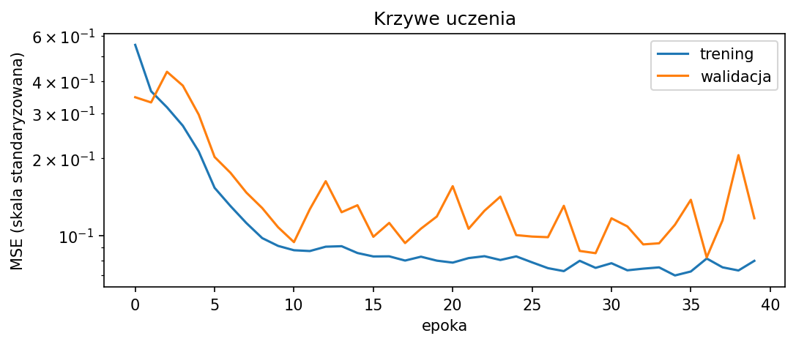
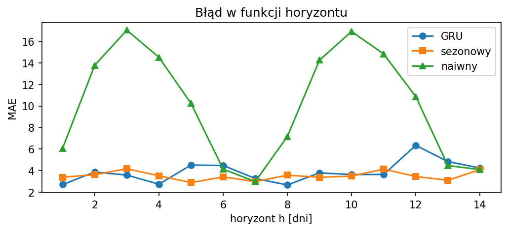

# Sprawozdanie laboratoryjne

**Przedmiot:** Uczenie głębokie w systemach rozpoznawania i przetwarzania mowy  
**Temat:** Laboratorium 3 — Prognozowanie szeregów czasowych: prognoza wielokrokowa i porównanie z baseline’ami  
**Autor:** Oskar Pietrzak
**Data:** 03.11.2026  

## 1. Cel ćwiczenia

Sprawdzić, czy model GRU poprawia prognozy dziennej sprzedaży względem prostych reguł w prognozie jedno- i wielokrokowej. Zakres obejmuje krzywe uczenia, ocenę na 14 dni, dobór długości okna na walidacji oraz porównanie dwóch ziaren losowych.

## 2. Metoda i implementacja

Wykorzystano kod z `cwiczenie_lab_03.ipynb` bez zmian w obliczeniach bazowych. Notebook `lab3_gru_rozwiazanie.ipynb` zawiera wykonane komórki, zestawienie wyników i interpretację. Używa wyłącznie NumPy, PyTorch i Matplotlib.

| Element | Konfiguracja |
| --- | --- |
| Dane | 1000 dni syntetycznej sprzedaży; ziarno NumPy = 0 |
| Szereg | `100 + 0,02t + 8 sin(2πt/7) + 15 sin(2πt/365) + ε`; `ε ~ N(0, 3²)` |
| Podział | Trening: dni 0–699; walidacja: 700–849; test: 850–999 |
| Standaryzacja | Tylko trening: μ = 106.9585; σ = 11.9952 |
| Model | GRU: 1 cecha, 32 jednostki; Linear(32, 1); 3393 parametry |
| Uczenie | Adam; lr = 0,01; MSE; 40 epok; batch = 64; bez clippingu |
| Warianty | Bazowy: okno 28, ziarno 0. Eksperyment: okna 3, 7, 28 × ziarna 0, 1 |
| Środowisko | CPU; PyTorch 2.15.0+cpu; NumPy 2.3.5 |

Standaryzacja: `z = (y − μ) / σ`. Powrót do skali: `y = z·σ + μ`. O przynależności okna do zbioru decyduje czas celu. Tasowanie gotowych przykładów treningowych nie miesza zbiorów. Wagi wybiera najmniejsze MSE walidacyjne; dla okna porównuje się średnie minimum z dwóch ziaren.

## 3. Wyniki

### 3.1. Model bazowy i krzywe uczenia

*Wykres 1. Straty treningowa i walidacyjna. Oś epok w kodzie bazowym jest liczona od 0.*

**Najlepsza epoka:** indeks 36, czyli 37. epoka, licząc od 1. **MSE walidacyjne:** 0.082233 w skali standaryzowanej (11.8322 w oryginalnej skali, jednostki sprzedaży²).

Obie straty wyraźnie spadają na początku. Później walidacja waha się, podczas gdy strata treningowa pozostaje niska. Końcowe skoki mogą wskazywać na niestabilność optymalizacji i lekkie przeuczenie, ale nie ma trwałego wzrostu straty walidacyjnej. Brak wyraźnych oznak niedouczenia. Trening obejmuje pełne 40 epok; na końcu przywracane są najlepsze wagi, bez wcześniejszego zatrzymania.

### 3.2. Porównanie prognoz jedno- i wielokrokowych

| Metoda | MAE 1 krok | RMSE 1 krok | MAE 14 kroków | RMSE 14 kroków |
| --- | --- | --- | --- | --- |
| GRU | 2.9131 | 3.5447 | 3.8795 | 4.7481 |
| Sezonowa | 3.2072 | 4.0722 | 3.5156 | 4.4248 |
| Naiwna | 5.4360 | 6.5073 | 10.0927 | 11.8523 |

MAE i RMSE podano w jednostkach sprzedaży. „14 kroków” oznacza agregację błędów z wszystkich `h = 1, …, 14`, a nie wyłącznie błąd w 14. dniu.

**Jednokrokowo:** 150 celów, dni 850–999; każde okno zawiera rzeczywiste obserwacje. **Wielokrokowo:** `H = 14`, starty co 14 dni: 850, 864, …, 976 (10 startów, 140 celów, dni 850–989). Końcowe 10 dni testu nie tworzy pełnego odcinka. W każdym trybie wszystkie metody oceniono na tych samych celach.

GRU przewiduje rekurencyjnie. Reguła sezonowa powtarza ostatni znany tydzień: `y[t₀ − 7 + ((h − 1) mod 7)]`, a naiwna powtarza `y[t₀ − 1]`, dla `h = 1, …, 14`. W obrębie odcinka żadna metoda nie korzysta z nowych obserwacji. Kolejny start może wykorzystać wszystkie dane znane w jego chwili.

### 3.3. Błąd w funkcji horyzontu

*Wykres 2. MAE dla każdego horyzontu, uśrednione po tych samych 10 startach.*

MAE GRU przy `h = 1` wynosi 2.71, a przy `h = 14` 4.24. Największy błąd występuje przy `h = 12` (6.34). Błąd nie rośnie monotonicznie: wpływ mają faza sezonowości, losowy szum i mała liczba startów. Średnio GRU traci przewagę nad regułą sezonową przy prognozowaniu wielu kroków.

### 3.4. Wpływ długości okna

| Okno | Ziarno | Val MSE stand. | Val MSE oryg. | MAE 1 krok | MAE 14 kroków |
| --- | --- | --- | --- | --- | --- |
| 3 | 0 | 0.256735 | 36.9405 | 4.9997 | 7.1831 |
| 3 | 1 | 0.248570 | 35.7658 | 5.0364 | 7.4136 |
| 7 | 0 | 0.085545 | 12.3087 | 2.9039 | 4.2127 |
| 7 | 1 | 0.089618 | 12.8947 | 2.8806 | 3.8904 |
| 28 | 0 | 0.082233 | 11.8322 | 2.9131 | 3.8795 |
| 28 | 1 | 0.085022 | 12.2334 | 3.0090 | 4.2924 |

`Val MSE oryg. = Val MSE stand. × σ²`; jednostką MSE w oryginalnej skali jest kwadrat jednostki sprzedaży. Pokazano najmniejszą stratę z 40 epok. Modele uczono od zera; pozostałe ustawienia były stałe.

| Okno | Średnie val MSE stand. | Średnie val MSE oryg. | Średnie MAE 1 | Średnie MAE 14 | Rozstęp MAE 1 | Rozstęp MAE 14 |
| --- | --- | --- | --- | --- | --- | --- |
| 3 | 0.252652 | 36.3532 | 5.0180 | 7.2984 | 0.0367 | 0.2305 |
| 7 | 0.087581 | 12.6017 | 2.8922 | 4.0516 | 0.0234 | 0.3223 |
| 28 | 0.083627 | 12.0328 | 2.9611 | 4.0860 | 0.0959 | 0.4130 |

**Wybrano okno 28 dni** według najniższego średniego MSE walidacyjnego. Rozstęp to maksimum minus minimum z dwóch ziaren. Nie dobierano okna według wyników testowych.

## 4. Analiza i interpretacja

1. Czy GRU bije baseline’y jedno- i wielokrokowo? Dlaczego wyniki się różnią?
Jednokrokowo tak: MAE GRU = 2,91, sezonowego = 3,21, naiwnego = 5,44. Wielokrokowo GRU (3,88) wygrywa tylko z naiwnym (10,09), a przegrywa z sezonowym (3,52), ponieważ błędy prognoz rekurencyjnych się kumulują.

2. Jak daleko jest wynik jednokrokowy od granicy szumu MAE ≈ 2,39?
MAE GRU = 2,91 jest wyższe o około 0,52 jednostki, czyli o 22%.

3. Dlaczego okno 3 dni daje gorszy wynik? Czy dłuższe okno coś poprawia?
Nie obejmuje pełnego cyklu tygodniowego, co utrudnia rozpoznanie sezonowości. Okno 7 dni wyraźnie pomaga; 28 dni ma najlepszą walidację, ale nie daje stałej poprawy na teście względem 7 dni.

4. Czy różnice między wariantami są większe niż rozrzut między ziarnami?
Tak dla okna 3 dni względem 7 i 28 dni. Różnice między oknami 7 i 28 dni są małe względem obserwowanego rozrzutu, szczególnie wielokrokowo; dwa ziarna nie pozwalają wskazać wyraźnej przewagi.

5. Co przenosi się na modele mowy, np. syntezę krok po kroku?
Okno odpowiada kontekstowi ramek mowy: zbyt krótki utrudnia uchwycenie zależności. W autoregresyjnej syntezie, np. WaveRNN, błędna prognoza staje się wejściem kolejnego kroku i może powodować kumulację błędów.
## 5. Wnioski

GRU poprawia prognozę jednokrokową względem obu baseline’ów, ale przy rekurencyjnej prognozie na 14 dni najlepsza jest reguła sezonowa. Okno obejmujące co najmniej tydzień jest wyraźnie lepsze od 3 dni. Wybrano 28 dni według walidacji; przewaga nad 7 dniami jest niewielka i zależy od losowania. Dalsze sprawdzenie wymaga większej liczby ziaren oraz walidacji kroczącej. Dla ograniczenia kumulacji błędów można porównać GRU rekurencyjne z modelem przewidującym od razu 14 wartości. Nie wykonywano nieobowiązkowego wariantu na własnym szeregu.
